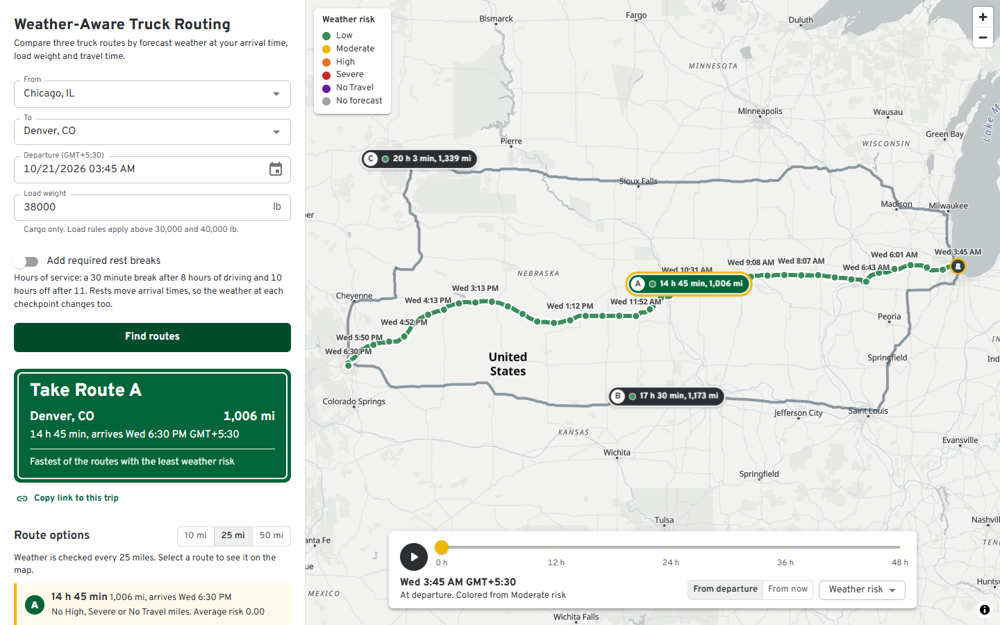
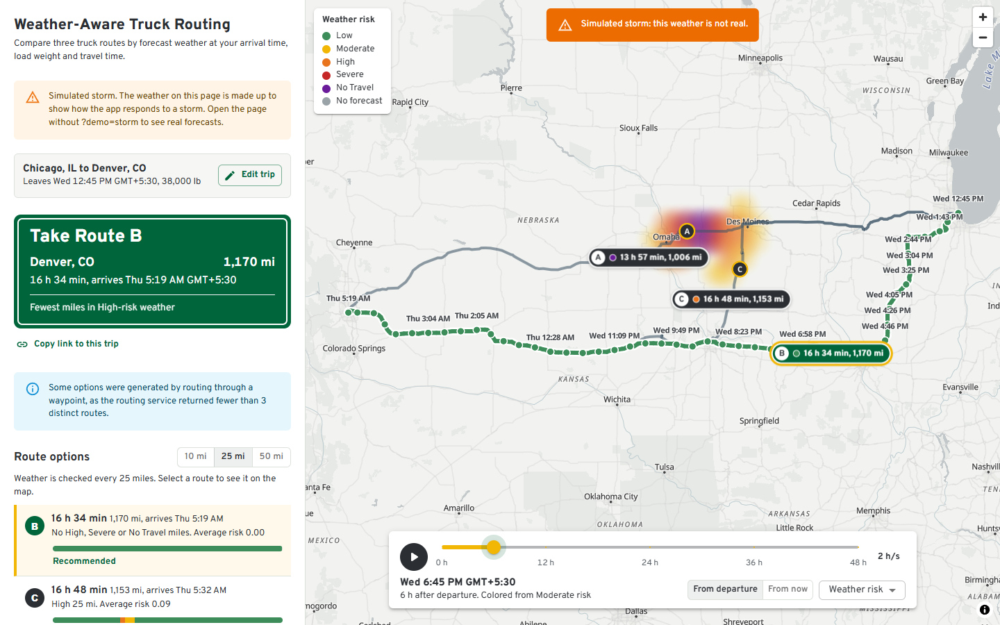

# Weather-Aware Truck Routing

Plan a truck trip and see which of three routes is safest to drive. The app checks the forecast at the moment the truck reaches each point on each route, applies the load-weight rules, and recommends a route by weather risk and travel time.

**Live app:** [truck-routing.zaidansari.tech](https://truck-routing.zaidansari.tech) &nbsp;|&nbsp; **Walkthrough video:** _link added after recording_

**Jump to:** [how routes are compared](#how-the-recommendation-is-made) | [run it locally](#run-it-locally) | [tests](#tests-and-quality) | [decision log](docs/decisions.md)



<details>
<summary>Demo mode: a simulated storm (labelled in the app) on the fastest route, with the recommendation moved to Route B</summary>



</details>

## What it does

| The brief asks for | Where it is |
|---|---|
| Origin, destination, departure date and time, load weight | Trip form with place search (US and Canada), a date-time picker in your time zone, load in pounds |
| 3 route options from a routing API | TomTom truck routing with your load's weight; near-duplicate routes are replaced ([DR-015](docs/decisions.md#dr-015-guaranteeing-distinct-route-options)) |
| Weather every 10 / 25 / 50 miles at the truck's arrival time | Spacing switch above the route list (switching back to a spacing already seen is instant) |
| Risk from the wind, rain and snow table plus the load rules | Every checkpoint shows its level, the condition that set it, and any load rule that raised it |
| Recommend the best route, balancing risk and travel time | The guide sign at the top, the "Why Route A" panel, and a note when a riskier route is much faster |
| All routes, checkpoints, risk levels, ETAs and summaries on a map | Route lines (the selected one colored by risk), checkpoint dots with arrival times, popups, and a summary chip per route |
| Weather heatmap along the trip corridor with a 0 to 48 hour slider | Forecast grid around all three routes; slider in 15 minute steps with play (1, 2 or 6 forecast hours a second) and a flag where each truck arrives |
| | Layers: risk for your load (default, matches the checkpoint dots), weather only, wind, rain, snow |
| Clear explanation | "How it works" under the title: risk table, load rules, ranking order and what the map shows |
| Extra: best time to leave | Re-scores the routes for departures up to 24 hours later and suggests the safest one ([DR-022](docs/decisions.md#dr-022-departure-time-advisor)) |
| Extra: trucks on the timeline | A marker per route moves with the forecast slider, so you can watch each truck meet the weather ([DR-024](docs/decisions.md#dr-024-trucks-on-the-timeline)) |
| Extra: required rest breaks | Optional hours-of-service breaks added to arrival times, which changes the forecast at each checkpoint ([DR-025](docs/decisions.md#dr-025-hours-of-service-rest-breaks)) |
| Extra: shareable links | The address holds the trip, and "Copy link to this trip" shares it; opening a link plans the same trip ([DR-027](docs/decisions.md#dr-027-shareable-trip-links)) |
| Demo: simulated storm | Follow "try it with a simulated storm" on the start screen (or open `?demo=storm`) to lay a clearly labelled synthetic storm over the real forecast, for when the weather is calm ([DR-026](docs/decisions.md#dr-026-simulated-storm-demo-mode)) |

## How the recommendation is made

1. **Routes.** TomTom truck routing (`travelMode=truck`) with the gross vehicle weight: your cargo plus an assumed 35,000 lb tractor-trailer, capped at the 80,000 lb federal limit. It asks for 2 alternatives, which returns the 3 routes in 4.7 s instead of 11 to 19 s for 5 ([DR-002](docs/decisions.md#dr-002-request-2-alternatives-not-5)).
2. **Checkpoints and arrival times.** Checkpoints sit at mile 0, every N miles, and the destination. Arrival times come from TomTom's per-point travel times, not an average speed: leaving Chicago, a constant-speed estimate would be about 45 minutes early by mile 50 ([DR-003](docs/decisions.md#dr-003-checkpoint-etas-from-tomtom-progress-data)).
3. **Weather at the arrival time.** Open-Meteo hourly forecasts (NOAA HRRR in North America). Rain and snow totals are read from the hour the truck is driving through, and wind is interpolated between hours ([DR-005](docs/decisions.md#dr-005-which-weather-fields-and-how-to-align-them-with-etas)).
4. **Risk.** Each checkpoint takes the worst of wind, rain and snow:

   | Condition | Low | Moderate | High | Severe | No Travel |
   |---|---|---|---|---|---|
   | Wind (mph) | under 25 | 25 to 34 | 35 to 44 | 45 to 54 | 55 or more |
   | Rain (in/hr) | under 0.10 | 0.10 to 0.25 | 0.25 to 0.50 | 0.50 to 1.00 | over 1.00 |
   | Snow (in/hr) | under 0.5 | 0.5 to 1.0 | 1.0 to 2.0 | 2.0 to 3.0 | over 3.0 |

   Then the load rules, which can only raise the level: 45 to 54 mph wind with more than 30,000 lb is No Travel, and 35 to 44 mph wind with more than 40,000 lb is Severe.
5. **Ranking.** Routes are compared in this order, each step only breaking ties in the one before: fewest No Travel miles, fewest Severe miles, fewest High miles, lowest average risk, shortest travel time.

## Where the code is

| Part | Files |
|---|---|
| Risk table and load rules | `backend/planner/domain/risk.py` (`Thresholds.classify`, `load_rule_level`, `assess`) |
| Checkpoints every 10/25/50 mi and their arrival times | `backend/planner/domain/checkpoints.py` (`build_profile`, `checkpoint_miles`, `place_checkpoints`) |
| Weather at the arrival time | `backend/planner/domain/forecast.py` (`weather_at`) |
| Ranking and the reason shown for it | `backend/planner/domain/ranking.py` (`RouteScore.sort_key`, `rank`) |
| The whole plan: routes, checkpoints, forecasts, risk, ranking | `backend/planner/services/trip.py` (`plan_trip`) |
| TomTom and Open-Meteo clients, caching and batching | `backend/planner/services/tomtom.py`, `backend/planner/services/openmeteo.py` |
| Heatmap frames | `backend/planner/services/corridor.py`, `backend/planner/domain/corridor.py` |
| Heatmap on the map (GPU blending between hours) | `frontend/src/lib/heatmap.ts`, `frontend/src/components/useHeatLayer.ts` |
| Timeline slider and trucks | `frontend/src/components/TimelineBar.tsx`, `frontend/src/components/useTruckLayer.ts`, `frontend/src/lib/trucks.ts` |
| Map, routes, checkpoints, popups | `frontend/src/components/MapView.tsx`, `frontend/src/lib/mapData.ts`, `frontend/src/lib/popup.ts` |

The domain modules are pure functions with no I/O, so each rule can be read and tested on its own.

## Assumptions

The brief leaves a few things open. Each choice below is a named constant in the code and has a unit test.

| Question | Choice | Why |
|---|---|---|
| Ranges that touch, e.g. rain 0.25 is in both Moderate and High | Each band includes its lower bound. No Travel follows the table's symbols: wind 55 mph is No Travel, rain exactly 1.00 and snow exactly 3.0 in/hr are Severe | The only reading consistent with every symbol in the table ([DR-006](docs/decisions.md#dr-006-interpreting-the-risk-table-boundaries)) |
| No Travel is not in the ranking list | Compared first, before Severe miles | Otherwise 10 No Travel miles would beat 20 Severe miles ([DR-007](docs/decisions.md#dr-007-no-travel-in-the-ranking)) |
| How exact the average-risk comparison is | Two decimals, the precision shown on screen | Otherwise a route an hour slower can win on a 0.0015 difference the screen shows as a tie ([DR-008](docs/decisions.md#dr-008-ranking-precision-for-average-risk)) |
| What a mile at a risk level means | Each checkpoint covers half the distance to each neighbor | Miles per level always add up to the route length |
| Average risk | Distance-weighted, Low 0 to No Travel 4 | Simple and explainable |
| Which weather values | Sustained wind, rain plus showers (liquid only), snowfall in inches | Total precipitation would count snow twice; gusts are shown but not scored |
| Precision | Wind is classified at 0.1 mph and rain and snow at 0.001 in/hr, the precision the app shows them at | A checkpoint never reads "35.0 mph" next to Moderate or "0.25 in/hr" next to Moderate ([DR-031](docs/decisions.md#dr-031-pre-submission-audit)) |
| Forecast missing for a checkpoint | Shown as "No forecast", never as Low; a route with no forecast at all ranks last | Missing data must not look safe ([DR-014](docs/decisions.md#dr-014-routes-without-a-forecast-rank-last)) |
| Where the 0 to 48 hour slider starts | At departure (which is "now" by default), with a switch to start from now | For a trip leaving tomorrow, the weather it drives through is what matters ([DR-009](docs/decisions.md#dr-009-forecast-slider-start-time)) |
| Load weight | Cargo weight, 0 to 80,000 lb | It is what the load rules describe |
| Departure range | From 15 minutes ago to 7 days ahead | Forecast skill drops sharply after a week |
| Does bad weather slow the truck? | No. Travel times are TomTom's (traffic and truck speeds), the same in any weather | The brief takes time from the routing API and risk from the weather; a speed penalty for snow or wind would be an invented rule. A risky route never wins on speed anyway, because risk is compared before time |

## Performance

Production build on a laptop, and the hosted app measured from India ([DR-020](docs/decisions.md#dr-020-heatmap-rendering-and-the-timeline-slider), [DR-029](docs/decisions.md#dr-029-review-against-a-scoring-checklist)):

| | Local | Hosted |
|---|---|---|
| New trip, nothing cached (3 routes, 25 mile checkpoints) | about 5 s, mostly TomTom routing | 5.2 s |
| Same trip again (cached) | 0.10 s | 0.6 s |
| Heatmap frames (about 250 grid points x 49 hours) | 0.5 s | 1.1 s |
| Three different trips at the same moment | | all done in 5.0 s, no errors |
| Switching checkpoint spacing | 0.7 s; instant for one already seen | |
| Timeline playback | 127 fps, worst frame 16 ms (headless Edge) | |
| Requests while dragging the slider | 0: the 49 hourly frames are already on the map and the GPU blends between hours | |

Forecasts are cached per 5 km grid cell for 30 minutes, so toggling the timeline start or planning a similar trip reuses them ([DR-017](docs/decisions.md#dr-017-forecast-batching-and-caching)).

## Architecture

```
Browser: React, TypeScript, Material UI, MapLibre GL (WebGL map)
   |  GET  /api/suggest/    place search (cached 24 h)
   |  POST /api/plan/       routes, checkpoints at the chosen 10/25/50 mi spacing, risk, ranking, heatmap grid
   |  POST /api/corridor/   49 hourly forecast frames for the heatmap grid
Django + Django REST Framework (stateless, no database)
   planner/domain/     pure logic, no I/O: geometry, checkpoints, forecast timing, risk, ranking, corridor grid
   planner/services/   TomTom and Open-Meteo clients, trip planning, heatmap frames
   Cache               routes, forecasts per grid cell and hour, place search (in memory, or Redis)
```

One Docker image serves both the API and the built frontend. OpenAPI docs are at `/api/docs/`.

**Why there is no database.** Nothing the app shows belongs to a user or outlives a forecast, so there are no records to keep. Reusable results are cached instead (routes 10 minutes, forecasts per 0.05° cell 30 minutes, place search 24 hours), and points that share a weather cell are fetched once, in batches of up to 300 locations. Saved trips or accounts would change this: a Postgres `Trip` table indexed by owner, plus auth ([DR-012](docs/decisions.md#dr-012-stateless-backend-no-database)).

**Errors.** Every error is JSON `{"code", "message"}` (plus `fields` for invalid input), and the page shows the message:

| Status | Code | When |
|---|---|---|
| 400 | `invalid_input` | A field is missing or out of range (past departure, load over 80,000 lb, ...) |
| 422 | `no_route` | TomTom finds no truck route between the two places (for example across an ocean) |
| 429 | `rate_limited` | Too many requests from one address |
| 502 | `routing_unavailable`, `weather_unavailable` | TomTom or Open-Meteo failed |
| 503 | `weather_busy` | Open-Meteo's free quota is used up for the moment; try again shortly |
| 500 | `internal_error` | Anything unexpected (logged) |

Rate limits per address: plans 60 an hour, place search 600 an hour, heatmap frames 120 an hour.

## Hosting

Azure Container Apps in Central India: one Docker image, 0.5 vCPU and 1 GiB, at least one replica always running so there is no cold start. The TomTom key and Django secret are Container Apps secrets. One gunicorn worker with 8 threads, so the in-memory cache and the rate limits are shared by every request on a replica. The built app is served pre-compressed (gzip) with year-long caching for its hashed files. `deploy/azure-container-apps.sh` builds the image in Azure Container Registry and creates or updates the app ([DR-030](docs/decisions.md#dr-030-hosting-as-deployed)).

## Tests and quality

- **Backend:** 288 pytest tests, 100% branch coverage. Every risk threshold is tested just below and exactly at its edge, as are both load rules (30,000 vs 30,001 lb, 40,000 vs 40,001 lb). Ranking order, arrival-time interpolation and forecast-hour matching have dedicated tests. TomTom and Open-Meteo are mocked; a test fails if it reaches a live API.
- **Frontend:** 68 Vitest tests for formatting, map geometry and chip placement, popups, the heatmap expressions, the recommendation wording, share links and truck positions.
- **Browser checks:** the production build was driven in headless Edge for the example trip, a one-road trip (Key West to Miami), an unroutable trip (Honolulu to Denver), validation errors, phone width and keyboard order, with no console errors. This found and fixed a map-worker bug that only showed in production builds ([DR-021](docs/decisions.md#dr-021-browser-qa-and-the-production-map-worker)).
- **CI:** GitHub Actions runs ruff, pytest, oxlint, Prettier, Vitest, the TypeScript build and the Docker build on every push to `main` and every pull request.

## Run it locally

You need Python 3.10+, Node 22 and a free TomTom API key from [my.tomtom.com](https://my.tomtom.com).

Copy `.env.example` to `.env` and put your key in `TOMTOM_API_KEY`. The other defaults are set for local use.

Terminal 1, the API on http://127.0.0.1:8000:

```bash
cd backend
python -m venv .venv
source .venv/bin/activate       # Windows PowerShell: .venv\Scripts\Activate.ps1
pip install -r requirements-dev.txt
python manage.py runserver
```

Terminal 2, the app on http://localhost:5173 (it forwards `/api` to the backend):

```bash
cd frontend
npm install
npm run dev
```

Or run the production image:

```bash
docker build -t weather-truck-routing .
docker run --rm -p 8000:8000 --env-file .env weather-truck-routing
```

| Setting | Purpose |
|---|---|
| `TOMTOM_API_KEY` | Routing and place search |
| `DJANGO_SECRET_KEY` | Required when `DJANGO_DEBUG` is off |
| `DJANGO_DEBUG` | `true` for local development only |
| `DJANGO_ALLOWED_HOSTS`, `DJANGO_CSRF_TRUSTED_ORIGINS` | Production host names |
| `REDIS_URL` | Optional. Without it an in-memory cache is used |

Run the tests with `pytest` in `backend` (with the virtual environment active) and `npm test` in `frontend`. They need no API key and make no network calls.

## Known limitations

- Rest breaks are optional and model the daily hours-of-service limits only (8 h before a break, 11 h before 10 h off), not the weekly 60/70 hour limits.
- Open-Meteo's free tier is for non-commercial use. A production deployment would use their commercial plan.
- Place search covers the US and Canada, where the high-resolution HRRR model is available.
- Grid spacing for the heatmap grows with trip length (about 45 km for Chicago to Denver) to keep it under 300 points.
- The free weather tier counts every forecast location, about 400 for a new long trip, with limits of 600 per minute and 10,000 per day. The app waits out the per-minute limit once and explains hourly or daily limits ([DR-023](docs/decisions.md#dr-023-staying-inside-the-free-weather-quota)).
- The departure advisor reuses the planned departure's driving times for later departures; traffic at other hours is not re-queried.

## Credits

Routing and place search by [TomTom](https://developer.tomtom.com). Weather data by [Open-Meteo.com](https://open-meteo.com) (CC BY 4.0). Map tiles by [OpenFreeMap](https://openfreemap.org), map data &copy; [OpenStreetMap](https://www.openstreetmap.org/copyright) contributors. Typeface: Overpass, after the Highway Gothic lettering on US road signs.

Every design decision, with the options considered and the measurements behind it, is in [docs/decisions.md](docs/decisions.md).
